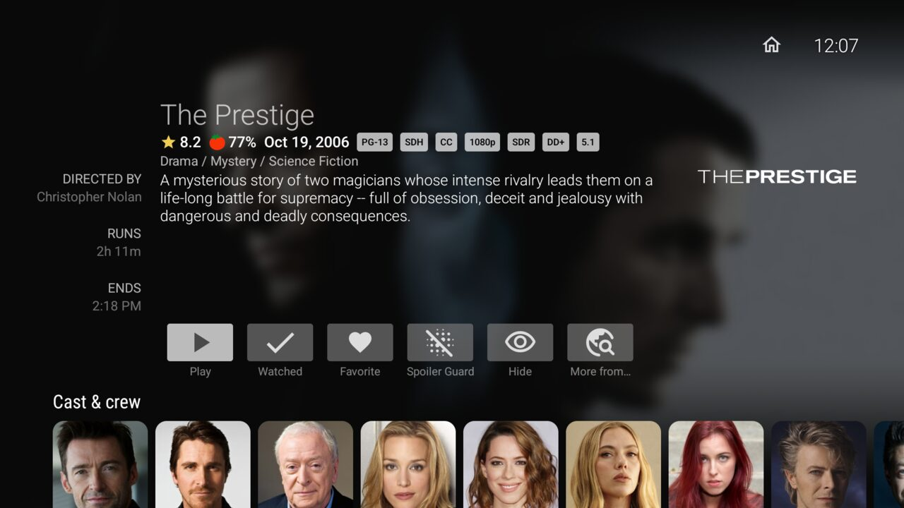
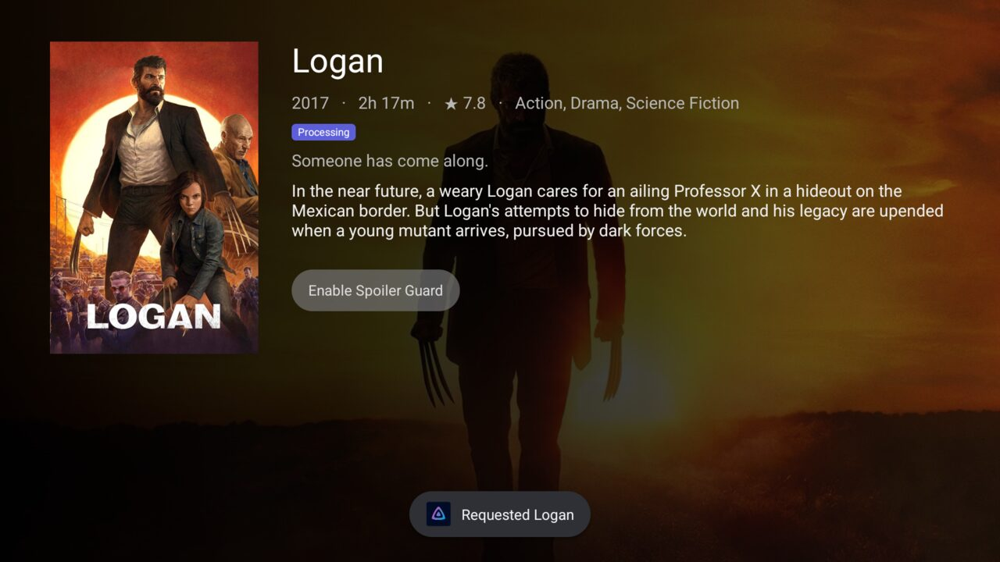
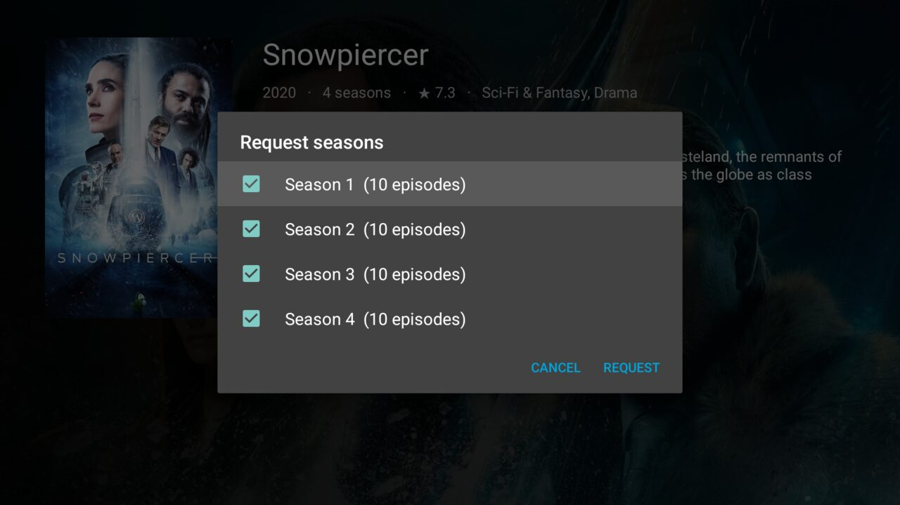

# Jellyfin Enhanced for Android TV

This is the official [Jellyfin Android TV client](https://github.com/jellyfin/jellyfin-androidtv) with a thin
[Jellyfin Enhanced](https://github.com/n00bcodr/Jellyfin-Enhanced) layer on top. Everything upstream does still work
the same way; the extra controls only appear when the server runs the Jellyfin Enhanced plugin and the feature is
turned on there.

It installs as its own app ("Jellyfin Enhanced", `org.jellyfin.androidtv.enhanced`), so it can sit next to the
official app.

## Features

| Feature | Where | What it does |
|---|---|---|
| Spoiler Guard | Movie and show details | Toggles Spoiler Guard for the title. The plugin hides overviews, episode titles, ratings and thumbnails server side, so every screen of the app respects it. |
| Hide / Unhide | Movie, show, season and episode details; card menu (long-press OK) | Hides the title everywhere the plugin filters (library, Next Up, Continue Watching, recommendations…). Episodes and seasons ask whether to hide just that item or the whole show. |
| Remove from Continue Watching / Next Up | Card menu on those home rows | Removes just that card from that row. Playing it again brings it back, as on the web. |
| More from… | Movie and show details | Opens Seerr discovery for the cast and crew, genres, studios/networks and tags of the title, or its Seerr recommendations. |
| Seerr rows | Details pages | "Recommended" and "Similar" titles on movies and shows, "More from <person>" on cast pages, and the missing parts of a collection. |
| Seerr details and requests | Any Seerr card | Poster, overview and status, with Request / Request in 4K, a season picker for shows, "Open in library" once it's available, and a pending Spoiler Guard opt-in for titles you haven't got yet. |

The buttons follow the plugin's own settings: Spoiler Guard needs `SpoilerBlurEnabled`, Hide needs Hidden Content
and the user's "show hide buttons" options, the remove-from-home entries need the user's "Remove from Continue
Watching" setting, and the Seerr features need Seerr to be set up in the plugin and the user to be linked.

The details screen only fits six buttons. When there are more, the least important ones (Favorite, trailers,
"More from…", then Hide) move into the "Other options" (⋯) button, the same way the official app handles its own.

## Screenshots

| | |
|---|---|
|  Spoiler Guard, Hide and More from… on a movie |  "More from…" lists cast, crew, genres, studios and tags |
|  Seerr discovery for an actor |  Seerr details after a request |
|  Requesting seasons of a show |  A show with Spoiler Guard on |
|  Card menu on Continue Watching |  "More from" row on a cast page |

Additional regression screenshots: [protected library details](docs/enhanced/seerr-library-spoiler-guard.png) and
[offline refresh with Retry](docs/enhanced/seerr-refresh-retry.png). The final optimized build is shown in
[director discovery](docs/enhanced/director-discovery-release.png).

## Install

Sideload the APK onto your TV, for example with `adb install jellyfin-enhanced.apk` or the Downloader app.
The local build delivered in `../artifacts/jellyfin-enhanced-androidtv.apk` is optimized with R8 and signed with
this machine's Android debug key for testing. Use your own persistent release key for distribution.

## Build

Needs JDK 21 and the Android SDK (platform 37).

```sh
./gradlew assembleDebug          # app/build/outputs/apk/debug/
./gradlew assembleRelease        # needs a keystore, see below
```

Release signing uses the same `keystore.*` / `signing.*` Gradle properties as upstream. Without them the release APK
is unsigned; sign it with `apksigner` before installing.

## Keeping up with upstream

All fork code lives in `app/src/enhanced/` (Kotlin sources and resources, added to the `main` source set by a block
at the end of `app/build.gradle.kts`). Upstream files only get the hook calls listed below, so merges rarely
conflict.

```sh
scripts/enhanced-sync-upstream.sh          # merges jellyfin/jellyfin-androidtv master
scripts/enhanced-sync-upstream.sh v0.20.0  # or a release tag
```

If a merge conflicts, it will be in one of these spots. Keep upstream's version and re-add the hook line:

| File | Hook |
|---|---|
| `app/build.gradle.kts` | `android { … }` block at the end: application id, `src/enhanced` source dirs, app name |
| `di/KoinInitializer.kt` | `enhancedModule` in the module list |
| `ui/itemdetail/FullDetailsFragment.java` | `EnhancedDetails.addButtons(…)` before the "more" button, `EnhancedDetails.addRows(…)` after `addAdditionalRows`, `EnhancedDetails.onItemClicked(…)` in the row click listener |
| `ui/itemdetail/FullDetailsFragmentHelper.kt` | `EnhancedDetails.addOverflowItems(…)` at the end of `showDetailsMenu` |
| `util/KeyProcessor.java` | `EnhancedItemMenu.contribute(…)` in `createItemMenu`, `EnhancedItemMenu.onMenuItemClick(…)` as the click listener's fallback |
| `ui/home/HomeRowsFragment.kt` | `EnhancedItemMenu.onItemSelected(…)` in the item selected listener |

`git grep -n "Enhanced" -- app/src/main` lists them all.

## How it talks to the plugin

The app calls the plugin's REST API (`/JellyfinEnhanced/…`) with the signed-in user's token, through the Jellyfin
SDK client the app already uses. Spoiler Guard and Hidden Content filtering happen on the server, in the normal
Jellyfin API responses, so the app only toggles them. Seerr calls go through the plugin's proxy, which acts as the
linked Seerr user and applies its permission checks.

| Area | Code |
|---|---|
| API client and plugin state | `enhanced/api/EnhancedApi.kt`, `enhanced/data/EnhancedRepository.kt` |
| Spoiler Guard | `enhanced/data/SpoilerGuardRepository.kt` |
| Hidden Content and home removal | `enhanced/data/HiddenContentRepository.kt` |
| Seerr discovery and requests | `enhanced/seerr/` |
| Details buttons and rows | `enhanced/ui/details/EnhancedDetails.kt` |
| Card menu | `enhanced/ui/menu/EnhancedItemMenu.kt` |
| Seerr screens | `enhanced/ui/seerr/` |

## Verification

Latest checks (22 October 2026): debug and optimized release builds pass; all 97 app unit tests pass, including
five regression tests for independent standard/4K request availability, deleted titles and seasons, and protected
cast/crew credits. The Android TV emulator was exercised against an isolated Jellyfin Enhanced lab server. The latest pass checked
protected actor credits and a return to Seerr details while the server was offline: cached story/artwork stayed
withheld, Retry received remote focus, and selecting it after recovery restored the protected details. Temporary
lab settings and title protection were restored afterwards. A smoke test of the final signed release APK also
confirmed library details, the overflow menu, director discovery, and Seerr details after R8 optimization.

## Not done yet

- Spoiler Guard for collections: collections open in the library browser, which has no button row.
- Seerr advanced request options (server, quality profile, root folder) and override rules. Requests use Seerr's
  defaults.
- Managing the hidden items list. Unhide from the item's details page, or use the web.
- Hidden Content is saved as a whole document, as on the web, so a hide made on another device at the same moment
  can be overwritten. The plugin has no per-item API for global hides.
- Seerr search from the app's search screen.
